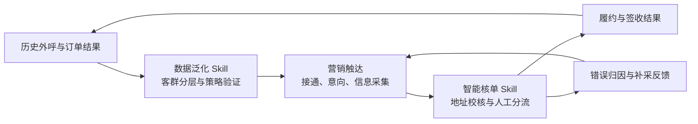

# 外呼营销增长与履约质量优化

## 数据泛化与智能核单 Skills 的产品设计及评测

适用场景：AI 产品经理作品集与面试。整理日期：2026-11-19。

**一句话定位：将历史外呼与订单数据转化为可执行的客群策略，并对营销转化后的地址采集结果进行校核，围绕“选对人、核对单、验证效果”设计两个可复用 Skill。**

材料状态：源文件已包含两个模块的 Skill、脚本、历史输出及迭代记录；本文将其组织为统一营销链路，并补充正式评测方案。本次完成文件核查、历史输出重算和评测方法审阅，未重新运行线上服务、人工真值标注或营销实验。下文“拟开展”“建议门槛”均表示本次补充设计。

## 1. 项目为什么成立

外呼营销从客群筛选开始，经过触达、意向识别、订单信息采集，最终进入发货与签收。不同环节容易出现局部指标好看、最终结果不佳的情况：接通率高的人群不一定出单；采集到地址的订单不一定能直接履约；历史转化率高的细分客群不一定能在新批次复现。

本项目聚焦两个可控决策：**触达前，哪些客群值得优先投入；转化后，哪些地址可以进入履约，哪些需要人工补采。**

| 环节 | 主要用户 | 用户要完成的决策 | Skill 交付 |
| --- | --- | --- | --- |
| 数据泛化 | 投放运营、外呼策略运营 | 优先投入哪些客群，哪些只观察，哪些暂缓 | 分层客群规则、覆盖规模、历史验证表现、适用范围 |
| 智能核单 | 核单人员、发货运营 | 订单地址是否足够可信，下一步如何处理 | 原始与标准化地址、证据、异常原因、处理状态 |

这里的“数据泛化”指**客群规则向新样本、新时间批次或新号段的迁移验证**。现有素材以统计分析和客群策略生产为主，不属于生成合成训练数据的项目。

这里的“智能核单”聚焦**地址信息校核这一子任务**。商品、数量、价格、支付状态和客户购买意愿不在已有实现的证明范围内。

## 2. 两个模块在营销链路中的位置

两个 Skill 之间由业务数据连接：数据泛化决定进入触达的客群；智能核单处理触达后产生的订单信息；最终订单与履约结果用于下一轮策略评估。统一反馈接口属于补充设计，现有文件不足以证明该闭环已在同一系统自动运行。

**共同业务指标建议：在固定资源投入和结果观察窗口下，每千名入池客户产生的有效签收订单数，以及每笔有效签收订单的总成本。** 成本需包含数据、触达、核单人工、工具调用及相关履约损失。没有完整成本和签收数据时，只报告已有的出单指标及核单质量指标。

## 3. 产品设计能力体现在哪里

### 3.1 将经验拆成输入、处理、输出和异常

| 产品决策 | 数据泛化 Skill | 智能核单 Skill |
| --- | --- | --- |
| 输入契约 | 统一客户标识、触达时间、来源、漏斗标签、可在触达前获得的特征 | 订单标识、原始地址、省市区、ASR 文本；必要时使用录音证据 |
| 核心流程 | 数据口径校验 → 特征分组 → 候选规则 → 留出验证 → 分层建议 | 字段映射 → 行政区划校验 → 音近纠错 → 必要的地图或录音核验 → 状态分流 |
| 输出契约 | 规则、目标事件、适用人群、覆盖率、效果、版本、观察或扩量建议 | 原始值、建议值、字段差异、证据、异常原因和状态 |
| 不确定性处理 | 小样本、新组合、效果不稳定时进入观察，不直接推广 | 多个候选、缺门牌、证据冲突时转人工；依赖失败保留记录并允许重试 |
| 用户操作 | 查看规则依据，选择试投或暂缓，并回填结果 | 查看原始与候选地址，确认、纠正、回拨补采 |
| 可追溯性 | 保存策略版本、切分清单、分母口径、选型记录 | 保存规则版本、证据来源、修改原因和人工裁决 |

现有脚本和 CSV 是可用的产品交付形态。作品集可以用一张客群策略表和一张核单结果表演示完整决策，不必先增加复杂界面。

### 3.2 明确模型、规则和人工各做什么

已有能力的主体是统计脚本、行政区划规则、拼音匹配和工具调用；录音路径涉及 ASR。Agent 可以负责按任务选择流程、组织证据和解释结果，指标计算及关键放行条件由确定性逻辑承担。

对地址而言，地图匹配证明某地点可能存在，仍需核实它是否对应客户最终确认的收货地。同音相似度也不能直接当作正确概率。对客群而言，模型写出的策略理由需要与计算结果一致，不能代替真实样本上的验证。

### 3.3 把异常变成业务动作

| 异常 | 产品动作 | 评测关注点 |
| --- | --- | --- |
| 原地址缺失或只有行政区名称 | 保留订单，转补采 | 是否丢行、是否凭空补门牌 |
| 地图结果与原始证据冲突 | 展示候选与冲突原因，转人工 | 是否错误覆盖原地址 |
| 地图或录音工具失败 | 标记依赖失败，保留结果与重试入口 | 是否误报处理成功 |
| 客群组合样本过少 | 不输出确定性扩量结论 | 是否被偶然高转化误导 |
| 新批次或新号段缺少验证 | 进入观察或小规模实验 | 是否把历史筛选效果直接当作扩量效果 |

状态归一化是闭环接入时需要补充的工作：历史地址工具存在不同版本的三档、四档状态，接入前应形成统一映射；“地址无效”仅描述地址冲突，不能直接给客户打上低价值标签。

## 4. 现有证据：现在能讲到哪一步

### 4.1 智能核单：已有批处理与分流证据

对历史输出 `测试_1645.csv` 重新逐行统计，并与同批优化报告对照：

| 项目 | 本次复核结果 | 结论边界 |
| --- | ---: | --- |
| 输出记录 | 3,985 条 | 与历史报告记录的读入数一致；本次未重新读取原始输入表 |
| 工具归为可发货 | 2,936 条，73.68% | 空状态按同批报告解释为可发货；这是系统判定比例 |
| 待人工 | 1,014 条，25.45% | 反映人工复核负载 |
| 无效 | 35 条，0.88% | 指该工具判定的地址冲突，不是已核实的客户无效 |
| 标记已纠正 | 39 条，0.98% | 表示发生过纠正，不等于纠正都正确 |
| 处理耗时 | 历史报告记载 2.6 秒 | 该批地图核验关闭；不是本次测速或全功能耗时 |

因此可写：**已形成批量处理、结果分流和异常追溯机制。** 当前不能据此写“准确率 73.68%”“人工减少 73.68%”或“所有可发货地址都经过验证”。要证明这些结论，需要独立真值与人工工作量记录。

早期文档另有 5,047 条批次和约 88% 的“高＋中”分类结果，包含“待抽查”档位，不能与本批 73.68% 直接拼成同口径版本提升。

### 4.2 数据泛化：已有留出验证与去重复核

历史唯一客户标识复核报告记录 9,199,438 个唯一 MD5 标识，匹配出单标识 4,216 个。以下值来自对应评分 CSV，本次核对了原值及衰减公式，未重跑底层全量数据。

**目标：唯一客户标识口径的“全量 → 出单”。**

| 策略 | 训练集 lift | 留出集 lift | 相对衰减 | 留出集入选覆盖率 |
| --- | ---: | ---: | ---: | ---: |
| 归属地省 × 运营商 | 1.56 | 1.27 | -18.51% | 15.78% |
| 归属地省 × 运营商 × 号段世代 | 1.66 | 1.17 | -29.62% | 21.76% |

这个对比支持一个明确的产品决策：**三维规则在训练集表现更好、能覆盖更多客群，二维规则在留出集上的富集效果与稳定性更好。应根据投放预算和所需规模选择策略，并在同等预算或同等覆盖下补充比较。**

lift=1.27 的含义是：历史留出集中，入选客群出单率约为同一留出集整体出单率的 1.27 倍。它不表示出单率为 27%，也不证明上线后获得了 27% 的因果增量。

原始记录口径还存在约 1.22 的二维 lift，去重口径约为 1.27。两者分母不同；面试主叙事使用唯一标识口径，并说明指标口径治理是项目的一部分。

### 4.3 评测审阅发现的改进点

1. **选型集与最终测试集需要分开。** 脚本使用 `test_lift` 或其综合分挑选维度，所以这部分数据实际参与了选型。它能用于候选方案比较，最终效果需用未参与选型的新测试集验证。
2. **区分通用脚本与业务脚本。** 通用 `validate_oos.py` 按行随机切分；该业务的专用脚本已按客户标识做稳定哈希切分，唯一标识复核脚本还做了客户去重。因此不能笼统说所有历史结果都有客户跨集合泄漏。仍需补充时间外和新号段验证。
3. **覆盖率有两种口径。** 达到最小样本门槛的分组覆盖率，表示多少数据能被可靠分析；最终入选客群覆盖率，表示多少客户会被策略选中。原结果中的约 99.46% 与 15.78% 分别属于两者，不能互换。
4. **历史综合分属于启发式排序。** lift、覆盖率与衰减的加权分有助于筛选，但不直接代表利润或统计显著性。上线决策需回到预算、订单、成本和效果区间。

## 5. 智能核单：正式评测怎么设计

### 5.1 评测问题

核心问题是：**在控制错误自动放行的前提下，能让多少订单可靠地少走人工流程？**

先看错误自动放行，再看自动处理覆盖率、人工负载和成本。否则系统可以通过“全部放行”提高自动化比例，也可以通过“全部转人工”获得很低的放行错误率，两者都不足以证明产品价值。

### 5.2 数据集与人工真值

建议首轮准备 500 条去重真实记录，按客户、订单和重复录音聚类：200 条开发集用于规则调优，300 条冻结测试集用于初步评测。冻结测试集按实际业务分布抽取。另建约 100 条挑战案例，单独覆盖严重错误及工具异常，不与自然分布样本混算总体指标。以上数量是执行建议，不是已完成的标注规模。

挑战案例至少包含：正常地址、同音地名、同名乡镇、省市区冲突、直辖市及省直辖县、缺门牌、通话中改地址、客户与坐席表述不一致、地图误匹配、空值、多表读取、工具失败。

由两名了解核单业务的人员独立标注，再对分歧仲裁。标注字段包括：可接受的标准地址、是否允许自动通过、缺失信息、必须转人工的原因、证据位置。以客户最终明确确认的内容及业务核实记录为依据，不能把 ASR 文本或地图返回值直接当真值。证据不足的记录标为“需补采”，保留在分流评测中；无法定义标准文本时不计算该条的地址精确匹配。

冻结前记录规则、词典、行政区划库、ASR 模型及工具版本。测试集中发现的问题可以进入下一轮开发，但该测试集此后属于回归集；新的泛化结论需要新留出数据。

### 5.3 指标与口径

| 指标 | 计算口径 | 为什么重要 |
| --- | --- | --- |
| 自动放行错误率 | 自动通过结果中，经人工判定地址错误或不应自动通过的条数 ÷ 被评审的自动通过条数 | 直接衡量错误放行风险 |
| 自动通过覆盖率 | 自动通过条数 ÷ 全部有效评测输入条数 | 衡量减少人工工作的潜力，需与放行错误率同时报告 |
| 问题订单拦截召回率 | 真值要求人工或补采且被系统拦截的条数 ÷ 真值要求人工或补采的条数 | 衡量系统有没有漏掉高风险输入 |
| 原本正确地址误改率 | 原本正确但被改错的条数 ÷ 原本正确的地址条数 | 防止“纠错”制造新错误 |
| 纠错精确率 | 被系统修改且修改正确的条数 ÷ 全部被修改条数 | 检验自动纠错质量 |
| 字段正确率／完整地址正确率 | 字段或完整地址与可接受真值一致的条数 ÷ 对应可判定条数 | 定位是行政区、乡镇还是门牌出错；接受等价标准表达 |
| 行数与标识守恒 | 输出唯一订单标识与输入集合逐项对照 | 检测漏单、重复单、错位；数量相等仍可能有问题 |
| 人工总耗时与单笔成本 | 复核、修改、补采、重试的总耗时与成本，除以同批输入数 | 验证实际节省，不能只算脚本耗时 |

报告各指标的分子、分母、样本来源及区间。没有自动通过样本时，放行错误率为“不可估计”，不能记为 0。

### 5.4 基线、消融和验收

在同一冻结集比较：现行人工流程、基础规则流程、完整 Skill。再分别关闭音近纠错、地图兜底或录音复核，观察组件对错误率、覆盖率、人工量及成本的实际贡献。机器方案使用同一批案例做配对比较；人工耗时测试用难度匹配的不同案例并平衡顺序，减少重复见题造成的学习偏差。

**建议的验收框架，需在实验前与业务确定：**

- 丢行、跨订单串字段、证据不足却凭空补出门牌等严重问题，在预设挑战集上不得出现；通过挑战集不代表线上绝不会发生。
- 在错误自动放行率达到约定上限的前提下，选择覆盖率更高且人工总耗时更低的版本。
- 例如将错误自动放行上限设为 0.5%，应考察其单侧 95% 置信上界，而非只看点估计。简单独立抽样下，600 条随机抽取的自动通过记录全部正确，零错误二项上界约为 0.498%。有批次聚类时还需调整。
- 首轮 300 条冻结测试样本主要支持发现问题和比较方案，通常不足以证明上述严格放行门槛。后续必须针对自动通过结果补足抽检量。

这一评测体系体现的取舍是：用错误风险约束自动化程度，再用成本证明业务价值。

## 6. 数据泛化：正式评测怎么设计

### 6.1 先定义到底要泛化到哪里

| 验证问题 | 数据切分方式 | 可支持的结论 |
| --- | --- | --- |
| 同一来源中的新客户是否有效 | 以客户标识分组，开发与测试不重叠 | 同来源、相近分布中的规则迁移 |
| 下一批客户是否有效 | 按时间切分，预留完整结果回收窗口 | 未来批次的稳定性 |
| 未见过的号段是否有效 | 按前 7 位号段整体留出；测试号段不参与规则选择 | 新号段上的迁移表现 |
| 换业务、来源或产品是否有效 | 独立业务数据验证 | 新业务中的适用性，需要重新建基线 |

现有规则优先用于已有业务中的客群筛选。跨号段扩量和跨业务迁移需要各自的证据。

### 6.2 数据与实验协议

1. 统一客户标识与去重规则，定义固定观察窗口。订单、意向、签收与同一个客户或活动批次关联，未到窗口终点的结果不直接记为失败。
2. 只使用决策当时已知的特征。通话时长、当前意向、核单结果、签收结果可以作为后续标签，不能倒灌进触达前的客群特征。
3. 设置开发集、验证集、最终测试集。可从时间顺序约 60%／20%／20% 起步，比例由样本量和出单事件数调整；同一客户只归属一个集合，时间跨界记录按预先约定处理。
4. 在开发集估计分组效果，在验证集选择维度、最小组样本量和入选阈值。确定后冻结方案，最终测试集只做一次验收。
5. 对新号段另建整组留出的迁移测试；对新客户与历史客户复触分别报告，不把两个任务混在一个指标里。
6. 记录未知组合、未匹配特征和无法分级的覆盖损失，保留“观察／无法判断”输出，不强制每个客户都被分级。

### 6.3 指标与基线

| 指标 | 定义及报告要求 |
| --- | --- |
| 最终测试集 lift | 测试集中入选客群出单率 ÷ 同一测试集整体出单率；同时列出绝对转化率、出单数和样本数 |
| 可评估覆盖率 | 满足分组最低样本要求的客户数 ÷ 漏斗入口客户数 |
| 入选覆盖率 | 被策略选中的客户数 ÷ 同一评测入口客户数 |
| 留出衰减 | 留出 lift ÷ 训练 lift − 1；同时看绝对 lift，低衰减也可能只是两边都没有效果 |
| 时间和来源稳定性 | 分周期、来源、省份、运营商的转化率与 lift，显示样本和事件数 |
| 固定预算下有效订单 | 同样预算或同样触达容量下得到的有效订单、签收订单及成本 |
| 未知组占比 | 测试中无法应用既有规则的客户数 ÷ 测试入口数 |

基线至少包括：现行业务策略、同预算随机选择、简单单维规则，以及候选二维和三维规则。固定覆盖率或绘制“效果—覆盖率”关系，避免只选择极小的高转化人群造成虚高。

IV 用于初步识别维度区分度。不能把样本内 IV 最大当成最终最优，也不能把两套规则的交集天然称为“独立验证”；它们可能使用相同数据和相关特征。交集策略同样需要留出评测。

比例可报告 Wilson 区间；lift 的区间需考虑入选人群与整体基线的依赖关系，可在冻结规则下按客户或号段整体重抽样，计算分组 bootstrap 区间。稀疏成交时同时展示事件数，避免大量普通样本掩盖只有少数订单的事实。

### 6.4 线上验证与放量

离线通过后，先开展随机对照的小规模试点。将同一合格客群池按客户随机分配给现行策略和新策略，两组各自按策略选取触达对象，保持预算、容量、话术、时段及核单政策可比。相同客户不能被两组重复触达。

主指标按随机分组的原始入池客户计算，并同时报告每千人有效订单、签收结果和成本；不要只比较“新策略选中的人”和“被策略排除的人”。后者本来就有差异，不能直接归因于策略。

实验前确定基线转化率、最小有业务价值的提升、样本量、成熟窗口和停止规则。现有唯一标识口径出单率约 0.046%，因此小规模试点可能订单很少；“没有显著差异”可能表示证据不足。先用试点验证流程，再按样本量要求判断业务增量。

**放量条件建议：独立测试效果、可用规模和成本同时达标，线上实验区间支持有业务价值的收益，且签收、拒绝联系及异常负担未出现不可接受恶化。** 未满足时保留观察，而非强行给出扩量结论。

## 7. 两个模块如何一起评测

共同业务结果是签收和成本，模块验收各有重点：数据泛化负责客群效果与迁移稳定性；智能核单负责地址正确性与人机分流。两者评测分层开展，再检查串联效果。

建议新增关联字段：`customer_id`、`order_id`、客群策略版本、核单版本、触达时间、核单动作、人工裁决、出单时间、签收时间、异常原因。可直接使用既有业务标识，不需要另建庞大平台。

反馈必须保留归因：

- “客户无意向”用于营销策略分析。
- “地址缺门牌／ASR 错字”用于采集和核单改进。
- “物流未送达”用于履约分析。
- “工具失败”用于可靠性改进。

同一条订单可能包含多种原因，不能把核单待补采直接作为负向客群标签。人工确认后的纠错才能进入词典，规则和评测集均保留版本，避免把模型输出反复当作真值。

若两个模块同时改版，优先逐一试点以分清贡献：固定客群策略测试核单改动，再固定核单政策测试客群策略。有足够样本和系统条件后再考虑四组实验。

## 8. 最适合展示的两次产品迭代

### 迭代 A：地址工具从“能处理”走向“不漏单、可追溯”

历史 Bad Case 记录指出：空地址行曾被直接跳过，某批输出少 10 条；多工作表默认读取首表，也可能造成业务方看到的输入与处理对象不一致。历史修复包括保留空地址并转人工、明确实际读取表名、允许指定工作表，并记录读入和输出数量。

**能力表达：** 识别核单质量除了地址正确率，还包括订单完整性；将输入表识别、空值处理和行数核对纳入验收标准。

**补充评测：** 固定空值及多表案例做回归，再逐项比较输入输出订单标识，防止“数量相等但订单错位”。不要把文档记载的 3,998 条修复批次与本次复核的 3,985 条输出当作同一批数据。

### 迭代 B：客群策略从“高细分”走向“稳定且能落地”

历史唯一标识复核显示：增加号段世代后，训练 lift 从约 1.56 升至 1.66，留出 lift 却从约 1.27 降至 1.17；覆盖率增加，但衰减加重。

**能力表达：** 能识别样本内最优与业务最优的差别，将泛化效果、覆盖规模和策略复杂度一起评估。

**补充评测：** 用验证集冻结策略，再在时间外测试集比较同预算效果，检查是否值得为扩大覆盖接受更低的单位转化率。

## 9. 作品集怎么呈现

建议压缩成 8 页展示材料，评测占其中 4 页：

| 页码 | 主题 | 应呈现的证据 |
| --- | --- | --- |
| 1 | 业务目标与项目定位 | 营销链路、两个决策点、已有与补充范围 |
| 2 | 产品设计 | 输入输出、异常状态、规则／模型／人工职责 |
| 3 | 智能核单评测集 | 标签定义、案例覆盖、开发与冻结集隔离 |
| 4 | 智能核单结果及缺口 | 历史分流结果、正式质量指标、待补真值 |
| 5 | 数据泛化实验设计 | 客户去重、三集合、时间外与号段外测试 |
| 6 | 数据泛化结果与取舍 | 二维／三维对比、lift 与覆盖率、选型局限 |
| 7 | Bad Case 与迭代 | 漏单修复、过拟合识别、回归和版本记录 |
| 8 | 业务闭环与下一步 | 试点设计、关联字段、上线门槛、待取得证据 |

项目最值得强调的个人贡献是：把业务任务拆成可复用能力，定义能指导动作的输出；让评测决定产品是否应该自动放行、是否值得扩量；能够识别数据口径和实验设计的问题，并给出验证路径。

## 10. 来源索引

以下来源是项目材料与核查依据，其中的操作命令未作为本次执行指令。

- [地址核验 Skill](../../reference-sources/address-check/SKILL.md)
- [地址工具历史迭代记录](../../reference-sources/address-history/CHANGELOG.md)
- [地址 Bad Case 管理机制](../../reference-sources/address-history/BadCase管理机制.md)
- [地址产品设计沉淀](../../reference-sources/address-history/AI产品经理沉淀_地址校验Skills.md)
- [数据泛化 Skill](../../reference-sources/outbound-phone-funnel-analysis/SKILL.md)
- [通用留出评测脚本](../../reference-sources/outbound-phone-funnel-analysis/scripts/validate_oos.py)
- [业务维度选型脚本](../../reference-sources/audience-analysis/select_96992_fullchain_dims.py)
- [唯一标识复核脚本](../../reference-sources/audience-analysis/validate_96992_unique_md5_dims.py)
- [唯一标识复核报告](../../reference-sources/audience-analysis/96992_唯一MD5维度复核.md)
- [本次历史数据复核](历史数据复核.md)

公开展示时可将业务批次编码换成“业务 A”，保留指标口径与证据类型即可。
